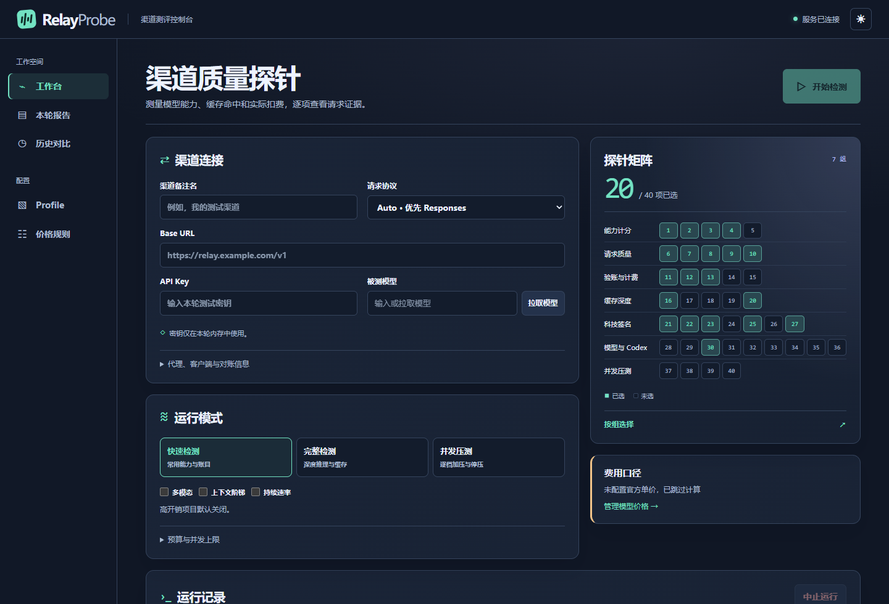
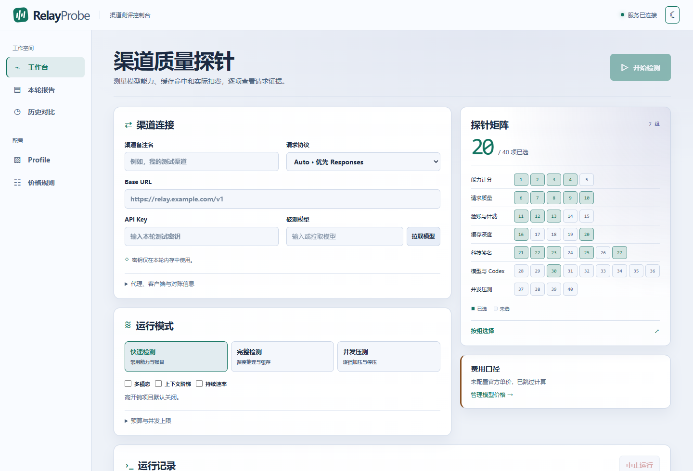
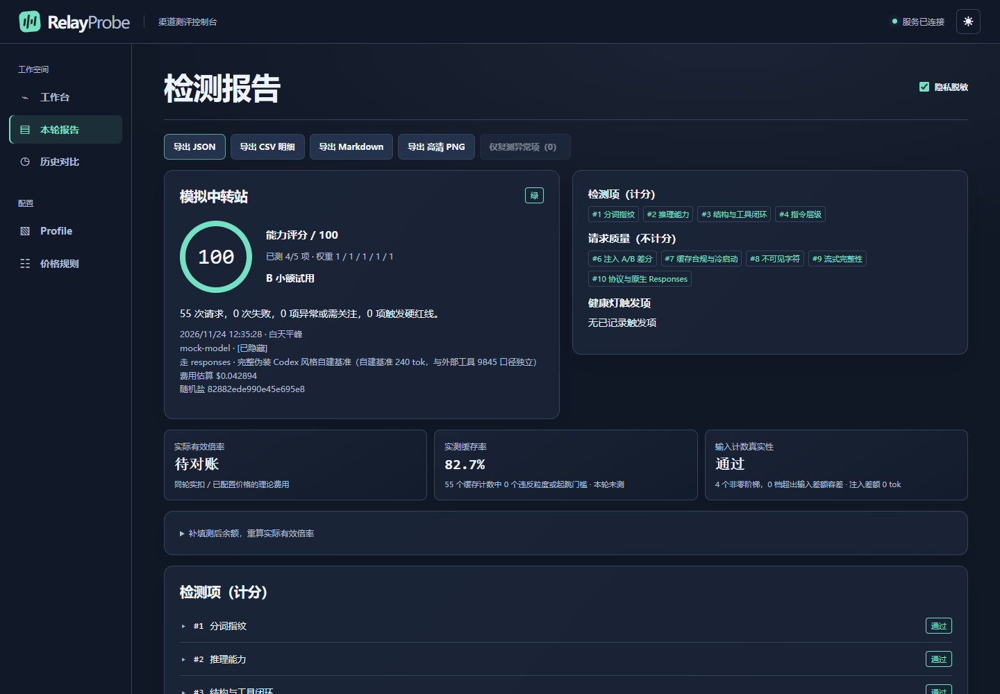

# RelayProbe · 中转站渠道质量探针

评测 OpenAI 兼容 API 的模型能力、缓存、账目和并发。40 项探针可按组或逐项选择，报告可展开每项结论对应的请求证据。

[下载 Windows 便携版与网页版](../../releases/latest) · [Python 网页版部署](relay-probe/README.md) · [Rust 源码构建](relay-probe-rust/README.md) · [验收记录](relay-probe-rust/VALIDATION.md)



## 选择运行方式

| 版本 | 启动方式 | 适用场景 |
| --- | --- | --- |
| [Rust 便携版](../../releases/latest) | Windows x64 解压后双击 `RelayProbe.exe`，自动打开本机控制台 | 日常测评，无需安装开发环境 |
| [Python 网页版](relay-probe/README.md) | 使用 Python 3.11+ 启动 FastAPI，再访问浏览器控制台 | Windows 本机使用或 Linux 自部署 |

两版提供 Responses / Chat Completions、实时进度、预算熔断、异常项复测、历史对比，并支持导出 JSON、CSV、Markdown 和高清 PNG。报告默认隐藏渠道域名。

### Windows 便携版

1. 从发布页下载 `RelayProbe-2.1.1-windows-x64.zip`，完整解压。
2. 双击 `RelayProbe.exe`。默认地址为 `http://127.0.0.1:8787`，端口占用时以启动窗口显示的地址为准。
3. 在控制台填写 Base URL、API Key 和模型。可点击「拉取模型」读取该渠道的模型列表。
4. 选择「快速检测」或在探针矩阵里勾选项目。需要费用与扣费对比时，在「价格规则」填写已核实单价。
5. 点击「开始检测」。结束后可展开请求证据、复测异常项或导出报告。

关闭启动窗口或按 Ctrl+C 可退出。高开销和持续速率项目默认关闭，运行会消耗所填写渠道的实际额度。

### Python 网页版

从发布页下载并解压 `RelayProbe-2.1.1-web.zip`，或克隆仓库后进入 `relay-probe`。在 Windows PowerShell 中启动。

```powershell
py -3.11 -m venv .venv
.\.venv\Scripts\python -m pip install -r requirements.txt
$env:HOST = '127.0.0.1'
.\.venv\Scripts\python -m app.main
```

打开 `http://127.0.0.1:8787`。Linux 部署、访问口令、Nginx SSE 转发和本机模拟站的操作见 [网页版说明](relay-probe/README.md)。

## Clash / Mihomo 的 Fake-IP 兼容

本机出现「SSRF 检测到目标域名使用 Fake-IP」时，在连接表单里点击 **启用本机网络兼容**，再重试。也可展开「代理、客户端与对账信息」，勾选 **本机代理与 Fake-IP 兼容**。使用 TUN 时可以留空代理 URL。使用显式本机代理时填写实际回环地址和端口。

选项在回环监听的本机控制台可用，当前页面内生效。HTTPS 目标需要填写域名，证书仍按原域名验证。混有内网、回环或链路本地答案的目标继续拦截。Base URL 指向真实内网服务时，独立使用受信环境的 `ALLOW_PRIVATE_TARGETS` 设置。

## 界面预览

| Python 网页版浅色工作台 | 移动布局 |
| --- | --- |
|  |  |



报告截图来自本地模拟站。分数、价格和缓存率用于演示界面。

## 源码与测试

| 路径 | 内容 |
| --- | --- |
| [`relay-probe-rust/`](relay-probe-rust/) | Rust 探针引擎、内嵌控制台、Windows 构建脚本和模拟测试 |
| [`relay-probe/`](relay-probe/) | Python / FastAPI 网页版、静态控制台、Linux 启动脚本和模拟测试 |
| [`docs/screenshots/`](docs/screenshots/) | Chromium 实拍截图 |

API Key 从控制台发给当前后端，仅用于当前任务。价格和报告历史保存在当前浏览器。公开部署前请在后端设置访问口令，并使用 HTTPS 反代保护传输。

第三方依赖许可随 [Rust 源码](relay-probe-rust/THIRD_PARTY_NOTICES.md) 和 Windows 便携包分发。两版随测试或运行附带的 `o200k_base` 词表来自 OpenAI tiktoken 公开词表。
